# Progress — duckmcp

## Scope

<!-- What this cycle delivers, in two or three sentences. -->

## Dependency graph

```mermaid
graph TD
  subgraph phase_0["Fase 0"]
    DMCP_TASK_01["DMCP-TASK-01<br/>Esqueleto de tools/duckmcp/: __init__, errors.py, env.py e duckmcp_selftest"]
    DMCP_TASK_02["DMCP-TASK-02<br/>`audit.py` — os sítios crus de MCP por projeto, o número do antes"]
    DMCP_TASK_03["DMCP-TASK-03<br/>Regras de desenho (a), (c), (d) no selftest, e o `controls.py` da lib"]
    DMCP_TASK_04["DMCP-TASK-04<br/>Fechamento da Fase 0 — o esqueleto"]
  end
  subgraph phase_1["Fase 1"]
    DMCP_TASK_05["DMCP-TASK-05<br/>`client.py` a partir do `mcp.py` de `f21182ea`, com servidor de teste"]
    DMCP_TASK_06["DMCP-TASK-06<br/>`cli.py list/status/call`, e `tools/pes2/mcp.py` vira shim"]
    DMCP_TASK_07["DMCP-TASK-07<br/>Fechamento da Fase 1 — o transporte"]
  end
  subgraph phase_2["Fase 2"]
    DMCP_TASK_08["DMCP-TASK-08<br/>`fork.py` agnóstico de jogo — janela pelo PID, título opcional, `hide_window` e `size_window`"]
    DMCP_TASK_09["DMCP-TASK-09<br/>`cli.py launch/kill/status/recipe/which`, shim do `pes2/fork.py`, e os lançadores apontados"]
    DMCP_TASK_10["DMCP-TASK-10<br/>`duckmcp_live` — subir o fork com um `.cue` qualquer, andar, ler e matar"]
    DMCP_TASK_11["DMCP-TASK-11<br/>Fechamento da Fase 2 — o lançador"]
  end
  subgraph phase_3["Fase 3"]
    DMCP_TASK_12["DMCP-TASK-12<br/>`buttons.py` e `session.py` — a sessão, com `game()`"]
    DMCP_TASK_13["DMCP-TASK-13<br/>`psx.py`, `gpu.py`, `png.py` e `vram.py`"]
    DMCP_TASK_14["DMCP-TASK-14<br/>`savestate.py` movido para a lib, com shim no `pes2`"]
    DMCP_TASK_15["DMCP-TASK-15<br/>Fechamento da Fase 3 — as primitivas"]
  end
  subgraph phase_4["Fase 4"]
    DMCP_TASK_16["DMCP-TASK-16<br/>`debug.py` — uma espera, breakpoints que sempre limpam, `who_writes` e watches"]
    DMCP_TASK_17["DMCP-TASK-17<br/>Regra (b) como gate, e os controles da lib completos"]
    DMCP_TASK_18["DMCP-TASK-18<br/>Fechamento da Fase 4 — a depuração"]
  end
  subgraph phase_5["Fase 5"]
    DMCP_TASK_19["DMCP-TASK-19<br/>`pes2`: `mcp_drive.py` e `pad.py` sobre `Session`"]
    DMCP_TASK_20["DMCP-TASK-20<br/>`pes2`: `who_writes.py`, `drive.py` e `selftest.py` sobre `debug` e `env`"]
    DMCP_TASK_21["DMCP-TASK-21<br/>Fechamento da Fase 5 — a migração do pes2"]
  end
  subgraph phase_6["Fase 6"]
    DMCP_TASK_22["DMCP-TASK-22<br/>`looks`: `Oracle` sobre `Session`, e o `OneSession` some"]
    DMCP_TASK_23["DMCP-TASK-23<br/>`looks`: esperas e laços de breakpoint sobre `debug`"]
    DMCP_TASK_24["DMCP-TASK-24<br/>Fechamento da Fase 6 — a migração do looks"]
  end
  subgraph phase_7["Fase 7"]
    DMCP_TASK_25["DMCP-TASK-25<br/>`kits`: `dump_slot`, `matrix_stops`, `pose_capture`, `read_frame` e `vram` sobre a lib"]
    DMCP_TASK_26["DMCP-TASK-26<br/>`kits`: controles, `COPIED` e monkeypatch reapontados"]
    DMCP_TASK_27["DMCP-TASK-27<br/>Fechamento da Fase 7 — a migração do kits"]
  end
  subgraph phase_8["Fase 8"]
    DMCP_TASK_28["DMCP-TASK-28<br/>Documentação: `CLAUDE.md`, a §6.11 do PES2 e a decisão no `perfil-kit2d.md`"]
    DMCP_TASK_29["DMCP-TASK-29<br/>Fechamento da Fase 8 — a documentação"]
  end
  subgraph phase_9["Fase 9"]
    DMCP_TASK_30["DMCP-TASK-30<br/>Apagar os shims, e o `audit.py` em zero"]
    DMCP_TASK_31["DMCP-TASK-31<br/>Verificação final: `duckmcp_live` em dois jogos e a bateria do §5.2"]
    DMCP_TASK_32["DMCP-TASK-32<br/>Fechamento da Fase 9 — o fechamento do ciclo"]
  end
  DMCP_TASK_01 --> DMCP_TASK_02
  DMCP_TASK_01 --> DMCP_TASK_03
  DMCP_TASK_02 --> DMCP_TASK_03
  DMCP_TASK_01 --> DMCP_TASK_04
  DMCP_TASK_02 --> DMCP_TASK_04
  DMCP_TASK_03 --> DMCP_TASK_04
  DMCP_TASK_04 --> DMCP_TASK_05
  DMCP_TASK_05 --> DMCP_TASK_06
  DMCP_TASK_05 --> DMCP_TASK_07
  DMCP_TASK_06 --> DMCP_TASK_07
  DMCP_TASK_07 --> DMCP_TASK_08
  DMCP_TASK_08 --> DMCP_TASK_09
  DMCP_TASK_09 --> DMCP_TASK_10
  DMCP_TASK_08 --> DMCP_TASK_11
  DMCP_TASK_09 --> DMCP_TASK_11
  DMCP_TASK_10 --> DMCP_TASK_11
  DMCP_TASK_11 --> DMCP_TASK_12
  DMCP_TASK_11 --> DMCP_TASK_13
  DMCP_TASK_11 --> DMCP_TASK_14
  DMCP_TASK_12 --> DMCP_TASK_15
  DMCP_TASK_13 --> DMCP_TASK_15
  DMCP_TASK_14 --> DMCP_TASK_15
  DMCP_TASK_15 --> DMCP_TASK_16
  DMCP_TASK_16 --> DMCP_TASK_17
  DMCP_TASK_16 --> DMCP_TASK_18
  DMCP_TASK_17 --> DMCP_TASK_18
  DMCP_TASK_18 --> DMCP_TASK_19
  DMCP_TASK_18 --> DMCP_TASK_20
  DMCP_TASK_19 --> DMCP_TASK_21
  DMCP_TASK_20 --> DMCP_TASK_21
  DMCP_TASK_18 --> DMCP_TASK_22
  DMCP_TASK_22 --> DMCP_TASK_23
  DMCP_TASK_22 --> DMCP_TASK_24
  DMCP_TASK_23 --> DMCP_TASK_24
  DMCP_TASK_24 --> DMCP_TASK_25
  DMCP_TASK_25 --> DMCP_TASK_26
  DMCP_TASK_25 --> DMCP_TASK_27
  DMCP_TASK_26 --> DMCP_TASK_27
  DMCP_TASK_21 --> DMCP_TASK_28
  DMCP_TASK_24 --> DMCP_TASK_28
  DMCP_TASK_27 --> DMCP_TASK_28
  DMCP_TASK_28 --> DMCP_TASK_29
  DMCP_TASK_29 --> DMCP_TASK_30
  DMCP_TASK_30 --> DMCP_TASK_31
  DMCP_TASK_30 --> DMCP_TASK_32
  DMCP_TASK_31 --> DMCP_TASK_32
```

<!-- Generated from each task's depends_on; prose explaining the order goes below the region. -->
<!-- rite:begin graph -->

<!-- rite:end -->

## Tasks

<!-- rite:begin tasks -->
| ID | Title | Phase | Type | Depends on | Status | Done on | Reviewed on | Review |
| --- | --- | --- | --- | --- | --- | --- | --- | --- |
| [DMCP-TASK-01](/docs/tasks/duckmcp/01-esqueleto.md) | Esqueleto de tools/duckmcp/: __init__, errors.py, env.py e duckmcp_selftest | 0 | infra | — | done | 2026-10-22 | 2026-10-22 | approved |
| [DMCP-TASK-02](/docs/tasks/duckmcp/02-audit.md) | `audit.py` — os sítios crus de MCP por projeto, o número do antes | 0 | ferramenta | DMCP-TASK-01 | done | 2026-10-22 | 2026-10-22 | approved |
| [DMCP-TASK-03](/docs/tasks/duckmcp/03-regras-de-desenho.md) | Regras de desenho (a), (c), (d) no selftest, e o `controls.py` da lib | 0 | verificação | DMCP-TASK-01, DMCP-TASK-02 | done | 2026-10-22 | 2026-10-22 | approved |
| [DMCP-TASK-04](/docs/tasks/duckmcp/04-fechamento-fase-0.md) | Fechamento da Fase 0 — o esqueleto | 0 | closing | DMCP-TASK-01, DMCP-TASK-02, DMCP-TASK-03 | done | 2026-10-22 | 2026-10-22 | approved |
| [DMCP-TASK-05](/docs/tasks/duckmcp/05-client.md) | `client.py` a partir do `mcp.py` de `f21182ea`, com servidor de teste | 1 | implementação | DMCP-TASK-04 | done | 2026-10-22 | 2026-10-22 | approved |
| [DMCP-TASK-06](/docs/tasks/duckmcp/06-cli-e-shim-mcp.md) | `cli.py list/status/call`, e `tools/pes2/mcp.py` vira shim | 1 | implementação | DMCP-TASK-05 | done | 2026-10-22 | 2026-10-22 | approved |
| [DMCP-TASK-07](/docs/tasks/duckmcp/07-fechamento-fase-1.md) | Fechamento da Fase 1 — o transporte | 1 | closing | DMCP-TASK-05, DMCP-TASK-06 | done | 2026-10-22 | 2026-10-22 | approved |
| [DMCP-TASK-08](/docs/tasks/duckmcp/08-fork.md) | `fork.py` agnóstico de jogo — janela pelo PID, título opcional, `hide_window` e `size_window` | 2 | implementação | DMCP-TASK-07 | done | 2026-10-22 | 2026-10-22 | approved |
| [DMCP-TASK-09](/docs/tasks/duckmcp/09-cli-fork-e-lancadores.md) | `cli.py launch/kill/status/recipe/which`, shim do `pes2/fork.py`, e os lançadores apontados | 2 | implementação | DMCP-TASK-08 | done | 2026-10-22 | 2026-10-22 | approved |
| [DMCP-TASK-10](/docs/tasks/duckmcp/10-duckmcp-live.md) | `duckmcp_live` — subir o fork com um `.cue` qualquer, andar, ler e matar | 2 | verificação | DMCP-TASK-09 | done | 2026-10-22 | 2026-10-22 | approved |
| [DMCP-TASK-11](/docs/tasks/duckmcp/11-fechamento-fase-2.md) | Fechamento da Fase 2 — o lançador | 2 | closing | DMCP-TASK-08, DMCP-TASK-09, DMCP-TASK-10 | done | 2026-10-22 | 2026-10-22 | approved |
| [DMCP-TASK-12](/docs/tasks/duckmcp/12-session.md) | `buttons.py` e `session.py` — a sessão, com `game()` | 3 | implementação | DMCP-TASK-11 | done | 2026-10-22 | 2026-10-22 | approved |
| [DMCP-TASK-13](/docs/tasks/duckmcp/13-hardware-e-pixels.md) | `psx.py`, `gpu.py`, `png.py` e `vram.py` | 3 | implementação | DMCP-TASK-11 | done | 2026-10-22 | 2026-10-22 | approved |
| [DMCP-TASK-14](/docs/tasks/duckmcp/14-savestate.md) | `savestate.py` movido para a lib, com shim no `pes2` | 3 | implementação | DMCP-TASK-11 | done | 2026-10-22 | 2026-10-22 | approved |
| [DMCP-TASK-15](/docs/tasks/duckmcp/15-fechamento-fase-3.md) | Fechamento da Fase 3 — as primitivas | 3 | closing | DMCP-TASK-12, DMCP-TASK-13, DMCP-TASK-14 | done | 2026-10-22 | 2026-10-22 | approved |
| [DMCP-TASK-16](/docs/tasks/duckmcp/16-debug.md) | `debug.py` — uma espera, breakpoints que sempre limpam, `who_writes` e watches | 4 | implementação | DMCP-TASK-15 | done | 2026-10-23 | 2026-10-23 | approved |
| [DMCP-TASK-17](/docs/tasks/duckmcp/17-regra-b.md) | Regra (b) como gate, e os controles da lib completos | 4 | verificação | DMCP-TASK-16 | done | 2026-10-23 | 2026-10-23 | approved |
| [DMCP-TASK-18](/docs/tasks/duckmcp/18-fechamento-fase-4.md) | Fechamento da Fase 4 — a depuração | 4 | closing | DMCP-TASK-16, DMCP-TASK-17 | done | 2026-10-23 | 2026-10-23 | approved |
| [DMCP-TASK-19](/docs/tasks/duckmcp/19-pes2-mcp-drive-e-pad.md) | `pes2`: `mcp_drive.py` e `pad.py` sobre `Session` | 5 | implementação | DMCP-TASK-18 | done | 2026-10-23 | 2026-10-23 | approved |
| [DMCP-TASK-20](/docs/tasks/duckmcp/20-pes2-who-writes-e-drive.md) | `pes2`: `who_writes.py`, `drive.py` e `selftest.py` sobre `debug` e `env` | 5 | implementação | DMCP-TASK-18 | done | 2026-10-23 | 2026-10-23 | approved |
| [DMCP-TASK-21](/docs/tasks/duckmcp/21-fechamento-fase-5.md) | Fechamento da Fase 5 — a migração do pes2 | 5 | closing | DMCP-TASK-19, DMCP-TASK-20 | done | 2026-10-23 | 2026-10-24 | approved |
| [DMCP-TASK-22](/docs/tasks/duckmcp/22-looks-oracle-session.md) | `looks`: `Oracle` sobre `Session`, e o `OneSession` some | 6 | implementação | DMCP-TASK-18 | done | 2026-10-23 | 2026-10-24 | approved |
| [DMCP-TASK-23](/docs/tasks/duckmcp/23-looks-breakpoints.md) | `looks`: esperas e laços de breakpoint sobre `debug` | 6 | implementação | DMCP-TASK-22 | done | 2026-10-23 | 2026-10-24 | approved |
| [DMCP-TASK-24](/docs/tasks/duckmcp/24-fechamento-fase-6.md) | Fechamento da Fase 6 — a migração do looks | 6 | closing | DMCP-TASK-22, DMCP-TASK-23 | done | 2026-10-24 | pending | awaiting |
| [DMCP-TASK-25](/docs/tasks/duckmcp/25-kits-oracle.md) | `kits`: `dump_slot`, `matrix_stops`, `pose_capture`, `read_frame` e `vram` sobre a lib | 7 | implementação | DMCP-TASK-24 | pending | — | — | — |
| [DMCP-TASK-26](/docs/tasks/duckmcp/26-kits-controles.md) | `kits`: controles, `COPIED` e monkeypatch reapontados | 7 | verificação | DMCP-TASK-25 | pending | — | — | — |
| [DMCP-TASK-27](/docs/tasks/duckmcp/27-fechamento-fase-7.md) | Fechamento da Fase 7 — a migração do kits | 7 | closing | DMCP-TASK-25, DMCP-TASK-26 | pending | — | — | — |
| [DMCP-TASK-28](/docs/tasks/duckmcp/28-documentacao.md) | Documentação: `CLAUDE.md`, a §6.11 do PES2 e a decisão no `perfil-kit2d.md` | 8 | documentação | DMCP-TASK-21, DMCP-TASK-24, DMCP-TASK-27 | pending | — | — | — |
| [DMCP-TASK-29](/docs/tasks/duckmcp/29-fechamento-fase-8.md) | Fechamento da Fase 8 — a documentação | 8 | closing | DMCP-TASK-28 | pending | — | — | — |
| [DMCP-TASK-30](/docs/tasks/duckmcp/30-apagar-shims.md) | Apagar os shims, e o `audit.py` em zero | 9 | implementação | DMCP-TASK-29 | pending | — | — | — |
| [DMCP-TASK-31](/docs/tasks/duckmcp/31-verificacao-final.md) | Verificação final: `duckmcp_live` em dois jogos e a bateria do §5.2 | 9 | verificação | DMCP-TASK-30 | pending | — | — | — |
| [DMCP-TASK-32](/docs/tasks/duckmcp/32-fechamento-fase-9.md) | Fechamento da Fase 9 — o fechamento do ciclo | 9 | closing | DMCP-TASK-30, DMCP-TASK-31 | pending | — | — | — |
<!-- rite:end -->

## Notes
