# Progress — kit2d

## Scope

<!-- What this cycle delivers, in two or three sentences. -->

## Dependency graph

```mermaid
graph TD
  subgraph phase_0["Fase 0"]
    K2D_TASK_01["K2D-TASK-01<br/>Esqueleto de tools/kit2d/: layout.py, selftest.py e kit2d_selftest no ctest"]
    K2D_TASK_02["K2D-TASK-02<br/>Sondas de disco versionadas: cli.py base e cli.py sprites reproduzem o §1.2"]
    K2D_TASK_03["K2D-TASK-03<br/>Base de carga do overlay medida na RAM pelo MCP"]
    K2D_TASK_04["K2D-TASK-04<br/>O que delimita uma lista, o que é attr e onde u,v caem na VRAM"]
    K2D_TASK_05["K2D-TASK-05<br/>Palavras 0 e 1 da paleta: o que os sprites amostram"]
    K2D_TASK_06["K2D-TASK-06<br/>Fechamento da fase 0 — as incógnitas medidas"]
  end
  subgraph phase_1["Fase 1"]
    K2D_TASK_07["K2D-TASK-07<br/>source.py e api.open_source: a ROM pelo conteúdo, e os 95 times por import do kits"]
    K2D_TASK_08["K2D-TASK-08<br/>graphics.py e palette.py: os três streams do DATSEL.BIN e BGR555"]
    K2D_TASK_09["K2D-TASK-09<br/>sprites.py e render.py: listas de 10 bytes e o compositor, api.render e api.render_model"]
    K2D_TASK_10["K2D-TASK-10<br/>CLI de leitura: info, teams, models, render, export; e kit2d_image no ctest"]
    K2D_TASK_11["K2D-TASK-11<br/>Fechamento da fase 1 — núcleo, leitura"]
  end
  subgraph phase_2["Fase 2"]
    K2D_TASK_12["K2D-TASK-12<br/>Confronto 1: render contra o quadro do emulador, com controle negativo"]
    K2D_TASK_13["K2D-TASK-13<br/>Fechamento da fase 2 — render contra o emulador"]
  end
  subgraph phase_3["Fase 3"]
    K2D_TASK_14["K2D-TASK-14<br/>edit.py: o buffer de edições, diff() em bytes e revert"]
    K2D_TASK_15["K2D-TASK-15<br/>writer.py: api.apply in-place na cópia, refuse_roms e round-trip"]
    K2D_TASK_16["K2D-TASK-16<br/>controls.py: os controles negativos plantados do §5"]
    K2D_TASK_17["K2D-TASK-17<br/>CLI de escrita: set-palette, set-model, set-radar, apply"]
    K2D_TASK_18["K2D-TASK-18<br/>Fechamento da fase 3 — núcleo, escrita"]
  end
  subgraph phase_4["Fase 4"]
    K2D_TASK_19["K2D-TASK-19<br/>Confronto 2: a mesma edição de paleta pela ferramenta e pelo Database::Save"]
    K2D_TASK_20["K2D-TASK-20<br/>Confronto 2 com o ed.exe: o roteiro tools/par/8.8 como terceiro lado (Linux)"]
    K2D_TASK_21["K2D-TASK-21<br/>Fechamento da fase 4 — gravação contra o port"]
  end
  subgraph phase_5["Fase 5"]
    K2D_TASK_22["K2D-TASK-22<br/>Janela mínima: abrir, time, titular e suplente lado a lado, 16 cores, catálogo i18n"]
    K2D_TASK_23["K2D-TASK-23<br/>Aplicar, Cancelar, Reverter este time e a guarda de sujo"]
    K2D_TASK_24["K2D-TASK-24<br/>kit2d_ui no ctest, make kit2d / kit2d-98 / make.ps1 kit2d e captura nas duas plataformas"]
    K2D_TASK_25["K2D-TASK-25<br/>Fechamento da fase 5 — a janela mínima"]
  end
  subgraph phase_6["Fase 6"]
    K2D_TASK_26["K2D-TASK-26<br/>Seletor de modelo: os 190 com miniatura na paleta do time e os times que usam"]
    K2D_TASK_27["K2D-TASK-27<br/>Radar: as 8 cores e o aviso da regra de pareamento"]
    K2D_TASK_28["K2D-TASK-28<br/>QUndoStack: desfazer e refazer dentro da sessão"]
    K2D_TASK_29["K2D-TASK-29<br/>Fechamento da fase 6 — modelo, radar e desfazer"]
  end
  subgraph phase_7["Fase 7"]
    K2D_TASK_30["K2D-TASK-30<br/>Confronto final: a edição aplicada aparece na tela do emulador"]
    K2D_TASK_31["K2D-TASK-31<br/>Fechamento da fase 7 — a edição no jogo"]
  end
  subgraph phase_8["Fase 8"]
    K2D_TASK_32["K2D-TASK-32<br/>Aba Diagnóstico: kit.problems na janela"]
    K2D_TASK_33["K2D-TASK-33<br/>golden-european-deluxe aberta sem recusa, com os avisos certos"]
    K2D_TASK_34["K2D-TASK-34<br/>Clubes de ML conferidos no emulador"]
    K2D_TASK_35["K2D-TASK-35<br/>Fechamento da fase 8 e a definição de pronto"]
  end
  K2D_TASK_01 --> K2D_TASK_02
  K2D_TASK_02 --> K2D_TASK_03
  K2D_TASK_03 --> K2D_TASK_04
  K2D_TASK_04 --> K2D_TASK_05
  K2D_TASK_01 --> K2D_TASK_06
  K2D_TASK_02 --> K2D_TASK_06
  K2D_TASK_03 --> K2D_TASK_06
  K2D_TASK_04 --> K2D_TASK_06
  K2D_TASK_05 --> K2D_TASK_06
  K2D_TASK_06 --> K2D_TASK_07
  K2D_TASK_06 --> K2D_TASK_08
  K2D_TASK_07 --> K2D_TASK_09
  K2D_TASK_08 --> K2D_TASK_09
  K2D_TASK_09 --> K2D_TASK_10
  K2D_TASK_07 --> K2D_TASK_11
  K2D_TASK_08 --> K2D_TASK_11
  K2D_TASK_09 --> K2D_TASK_11
  K2D_TASK_10 --> K2D_TASK_11
  K2D_TASK_11 --> K2D_TASK_12
  K2D_TASK_12 --> K2D_TASK_13
  K2D_TASK_11 --> K2D_TASK_14
  K2D_TASK_14 --> K2D_TASK_15
  K2D_TASK_15 --> K2D_TASK_16
  K2D_TASK_15 --> K2D_TASK_17
  K2D_TASK_14 --> K2D_TASK_18
  K2D_TASK_15 --> K2D_TASK_18
  K2D_TASK_16 --> K2D_TASK_18
  K2D_TASK_17 --> K2D_TASK_18
  K2D_TASK_18 --> K2D_TASK_19
  K2D_TASK_19 --> K2D_TASK_20
  K2D_TASK_19 --> K2D_TASK_21
  K2D_TASK_20 --> K2D_TASK_21
  K2D_TASK_13 --> K2D_TASK_22
  K2D_TASK_18 --> K2D_TASK_22
  K2D_TASK_22 --> K2D_TASK_23
  K2D_TASK_23 --> K2D_TASK_24
  K2D_TASK_22 --> K2D_TASK_25
  K2D_TASK_23 --> K2D_TASK_25
  K2D_TASK_24 --> K2D_TASK_25
  K2D_TASK_25 --> K2D_TASK_26
  K2D_TASK_25 --> K2D_TASK_27
  K2D_TASK_26 --> K2D_TASK_28
  K2D_TASK_27 --> K2D_TASK_28
  K2D_TASK_26 --> K2D_TASK_29
  K2D_TASK_27 --> K2D_TASK_29
  K2D_TASK_28 --> K2D_TASK_29
  K2D_TASK_21 --> K2D_TASK_30
  K2D_TASK_29 --> K2D_TASK_30
  K2D_TASK_30 --> K2D_TASK_31
  K2D_TASK_25 --> K2D_TASK_32
  K2D_TASK_32 --> K2D_TASK_33
  K2D_TASK_25 --> K2D_TASK_34
  K2D_TASK_31 --> K2D_TASK_35
  K2D_TASK_32 --> K2D_TASK_35
  K2D_TASK_33 --> K2D_TASK_35
  K2D_TASK_34 --> K2D_TASK_35
```

<!-- Generated from each task's depends_on; prose explaining the order goes below the region. -->
<!-- rite:begin graph -->

<!-- rite:end -->

## Tasks

<!-- rite:begin tasks -->
| ID | Title | Phase | Type | Depends on | Status | Done on | Reviewed on |
| --- | --- | --- | --- | --- | --- | --- | --- |
| [K2D-TASK-01](/docs/tasks/kit2d/01-esqueleto.md) | Esqueleto de tools/kit2d/: layout.py, selftest.py e kit2d_selftest no ctest | 0 | infra | — | done | 2026-10-22 | pending |
| [K2D-TASK-02](/docs/tasks/kit2d/02-sondas-de-disco.md) | Sondas de disco versionadas: cli.py base e cli.py sprites reproduzem o §1.2 | 0 | ferramenta | K2D-TASK-01 | pending | — | — |
| [K2D-TASK-03](/docs/tasks/kit2d/03-base-de-carga-na-ram.md) | Base de carga do overlay medida na RAM pelo MCP | 0 | engenharia-reversa | K2D-TASK-02 | pending | — | — |
| [K2D-TASK-04](/docs/tasks/kit2d/04-listas-e-attr-na-vram.md) | O que delimita uma lista, o que é attr e onde u,v caem na VRAM | 0 | engenharia-reversa | K2D-TASK-03 | pending | — | — |
| [K2D-TASK-05](/docs/tasks/kit2d/05-palavras-0-e-1.md) | Palavras 0 e 1 da paleta: o que os sprites amostram | 0 | engenharia-reversa | K2D-TASK-04 | pending | — | — |
| [K2D-TASK-06](/docs/tasks/kit2d/06-fechamento-fase-0.md) | Fechamento da fase 0 — as incógnitas medidas | 0 | closing | K2D-TASK-01, K2D-TASK-02, K2D-TASK-03, K2D-TASK-04, K2D-TASK-05 | pending | — | — |
| [K2D-TASK-07](/docs/tasks/kit2d/07-origem-e-times.md) | source.py e api.open_source: a ROM pelo conteúdo, e os 95 times por import do kits | 1 | implementação | K2D-TASK-06 | pending | — | — |
| [K2D-TASK-08](/docs/tasks/kit2d/08-graficos-e-paleta.md) | graphics.py e palette.py: os três streams do DATSEL.BIN e BGR555 | 1 | implementação | K2D-TASK-06 | pending | — | — |
| [K2D-TASK-09](/docs/tasks/kit2d/09-sprites-e-render.md) | sprites.py e render.py: listas de 10 bytes e o compositor, api.render e api.render_model | 1 | implementação | K2D-TASK-07, K2D-TASK-08 | pending | — | — |
| [K2D-TASK-10](/docs/tasks/kit2d/10-cli-de-leitura.md) | CLI de leitura: info, teams, models, render, export; e kit2d_image no ctest | 1 | ferramenta | K2D-TASK-09 | pending | — | — |
| [K2D-TASK-11](/docs/tasks/kit2d/11-fechamento-fase-1.md) | Fechamento da fase 1 — núcleo, leitura | 1 | closing | K2D-TASK-07, K2D-TASK-08, K2D-TASK-09, K2D-TASK-10 | pending | — | — |
| [K2D-TASK-12](/docs/tasks/kit2d/12-confronto-render-vram.md) | Confronto 1: render contra o quadro do emulador, com controle negativo | 2 | verificação | K2D-TASK-11 | pending | — | — |
| [K2D-TASK-13](/docs/tasks/kit2d/13-fechamento-fase-2.md) | Fechamento da fase 2 — render contra o emulador | 2 | closing | K2D-TASK-12 | pending | — | — |
| [K2D-TASK-14](/docs/tasks/kit2d/14-buffer-de-edicao.md) | edit.py: o buffer de edições, diff() em bytes e revert | 3 | implementação | K2D-TASK-11 | pending | — | — |
| [K2D-TASK-15](/docs/tasks/kit2d/15-gravacao-e-round-trip.md) | writer.py: api.apply in-place na cópia, refuse_roms e round-trip | 3 | implementação | K2D-TASK-14 | pending | — | — |
| [K2D-TASK-16](/docs/tasks/kit2d/16-controles-negativos.md) | controls.py: os controles negativos plantados do §5 | 3 | verificação | K2D-TASK-15 | pending | — | — |
| [K2D-TASK-17](/docs/tasks/kit2d/17-cli-de-escrita.md) | CLI de escrita: set-palette, set-model, set-radar, apply | 3 | ferramenta | K2D-TASK-15 | pending | — | — |
| [K2D-TASK-18](/docs/tasks/kit2d/18-fechamento-fase-3.md) | Fechamento da fase 3 — núcleo, escrita | 3 | closing | K2D-TASK-14, K2D-TASK-15, K2D-TASK-16, K2D-TASK-17 | pending | — | — |
| [K2D-TASK-19](/docs/tasks/kit2d/19-gravacao-contra-o-port.md) | Confronto 2: a mesma edição de paleta pela ferramenta e pelo Database::Save | 4 | verificação | K2D-TASK-18 | pending | — | — |
| [K2D-TASK-20](/docs/tasks/kit2d/20-gravacao-contra-o-ed-exe.md) | Confronto 2 com o ed.exe: o roteiro tools/par/8.8 como terceiro lado (Linux) | 4 | verificação | K2D-TASK-19 | pending | — | — |
| [K2D-TASK-21](/docs/tasks/kit2d/21-fechamento-fase-4.md) | Fechamento da fase 4 — gravação contra o port | 4 | closing | K2D-TASK-19, K2D-TASK-20 | pending | — | — |
| [K2D-TASK-22](/docs/tasks/kit2d/22-janela-minima.md) | Janela mínima: abrir, time, titular e suplente lado a lado, 16 cores, catálogo i18n | 5 | implementação | K2D-TASK-13, K2D-TASK-18 | pending | — | — |
| [K2D-TASK-23](/docs/tasks/kit2d/23-aplicar-e-sujo.md) | Aplicar, Cancelar, Reverter este time e a guarda de sujo | 5 | implementação | K2D-TASK-22 | pending | — | — |
| [K2D-TASK-24](/docs/tasks/kit2d/24-kit2d-ui-e-captura.md) | kit2d_ui no ctest, make kit2d / kit2d-98 / make.ps1 kit2d e captura nas duas plataformas | 5 | verificação | K2D-TASK-23 | pending | — | — |
| [K2D-TASK-25](/docs/tasks/kit2d/25-fechamento-fase-5.md) | Fechamento da fase 5 — a janela mínima | 5 | closing | K2D-TASK-22, K2D-TASK-23, K2D-TASK-24 | pending | — | — |
| [K2D-TASK-26](/docs/tasks/kit2d/26-seletor-de-modelo.md) | Seletor de modelo: os 190 com miniatura na paleta do time e os times que usam | 6 | implementação | K2D-TASK-25 | pending | — | — |
| [K2D-TASK-27](/docs/tasks/kit2d/27-radar.md) | Radar: as 8 cores e o aviso da regra de pareamento | 6 | implementação | K2D-TASK-25 | pending | — | — |
| [K2D-TASK-28](/docs/tasks/kit2d/28-desfazer.md) | QUndoStack: desfazer e refazer dentro da sessão | 6 | implementação | K2D-TASK-26, K2D-TASK-27 | pending | — | — |
| [K2D-TASK-29](/docs/tasks/kit2d/29-fechamento-fase-6.md) | Fechamento da fase 6 — modelo, radar e desfazer | 6 | closing | K2D-TASK-26, K2D-TASK-27, K2D-TASK-28 | pending | — | — |
| [K2D-TASK-30](/docs/tasks/kit2d/30-confronto-final.md) | Confronto final: a edição aplicada aparece na tela do emulador | 7 | verificação | K2D-TASK-21, K2D-TASK-29 | blocked | — | — |
| [K2D-TASK-31](/docs/tasks/kit2d/31-fechamento-fase-7.md) | Fechamento da fase 7 — a edição no jogo | 7 | closing | K2D-TASK-30 | pending | — | — |
| [K2D-TASK-32](/docs/tasks/kit2d/32-aba-diagnostico.md) | Aba Diagnóstico: kit.problems na janela | 8 | implementação | K2D-TASK-25 | pending | — | — |
| [K2D-TASK-33](/docs/tasks/kit2d/33-disco-hackeado.md) | golden-european-deluxe aberta sem recusa, com os avisos certos | 8 | verificação | K2D-TASK-32 | pending | — | — |
| [K2D-TASK-34](/docs/tasks/kit2d/34-clubes-de-ml.md) | Clubes de ML conferidos no emulador | 8 | engenharia-reversa | K2D-TASK-25 | blocked | — | — |
| [K2D-TASK-35](/docs/tasks/kit2d/35-fechamento-fase-8.md) | Fechamento da fase 8 e a definição de pronto | 8 | closing | K2D-TASK-31, K2D-TASK-32, K2D-TASK-33, K2D-TASK-34 | pending | — | — |
<!-- rite:end -->

## Notes
