# Progress — kits-replay

## Scope

Uma ferramenta de leitura do jogador no replay (`tools/kits/core/replay.py` e `tools/kits/replay.py`, com `--json`), e, sobre ela, o jogador 3D da aba mais perto do jogo: cabeça por jogador, goleiro pela família 13, pose de corrida, jogador real no seletor, dois times e câmera replay. Plano: [PLAN-KITS-REPLAY](/docs/PLAN-KITS-REPLAY.md).

## Dependency graph

```mermaid
graph TD
  subgraph phase_1["Fase 1"]
    KRP_TASK_01["KRP-TASK-01<br/>Leitor puro core/replay.py: Capture v0→v1, Frame, Figure e Walk, com os casos sintéticos migrados"]
    KRP_TASK_02["KRP-TASK-02<br/>oracle.py importa o leitor: análise movida, saída de --frame-json idêntica nas capturas existentes"]
    KRP_TASK_03["KRP-TASK-03<br/>Fechamento da fase 1"]
  end
  subgraph phase_2["Fase 2"]
    KRP_TASK_04["KRP-TASK-04<br/>replay.py de leitura: figures, figure, panel, walk e describe com --json kits-replay/1, e o alvo kits_replay"]
    KRP_TASK_05["KRP-TASK-05<br/>show --png e confront puro sobre a captura"]
    KRP_TASK_07["KRP-TASK-07<br/>replay.py capture com as guardas medidas, e o oracle capturando por ela"]
    KRP_TASK_06["KRP-TASK-06<br/>confront --tab: a aba contra o jogo, frente com frente e costas com costas"]
    KRP_TASK_08["KRP-TASK-08<br/>Fechamento da fase 2"]
  end
  subgraph phase_3["Fase 3"]
    KRP_TASK_09["KRP-TASK-09<br/>Medir a regra da cabeça (estilo, pele, cabelo e barba) contra o registro do disco nos 22"]
    KRP_TASK_10["KRP-TASK-10<br/>Cabeça pela tupla do jogador no scene_of e no match_scene, no CLI e na aba"]
    KRP_TASK_11["KRP-TASK-11<br/>Fechamento da fase 3"]
  end
  subgraph phase_4["Fase 4"]
    KRP_TASK_12["KRP-TASK-12<br/>Goleiro pela família 13, com a pose medida e a 92"]
    KRP_TASK_13["KRP-TASK-13<br/>Fechamento da fase 4"]
  end
  subgraph phase_5["Fase 5"]
    KRP_TASK_14["KRP-TASK-14<br/>Medir a corrida no ANIME.BIN: ponteiro do par na captura e pose --against-anime"]
    KRP_TASK_15["KRP-TASK-15<br/>Posar as famílias 2 e 13 pela corrida do arquivo, com seletor de caminhada ou corrida"]
    KRP_TASK_16["KRP-TASK-16<br/>Fechamento da fase 5"]
  end
  subgraph phase_6["Fase 6"]
    KRP_TASK_17["KRP-TASK-17<br/>Jogador real no seletor: time, jogador, número, capitão, cabeça, goleiro e manga"]
    KRP_TASK_18["KRP-TASK-18<br/>Vista dos dois times"]
    KRP_TASK_19["KRP-TASK-19<br/>Fechamento da fase 6"]
  end
  subgraph phase_7["Fase 7"]
    KRP_TASK_20["KRP-TASK-20<br/>Câmera replay em perspectiva no raster, e o preset na aba"]
    KRP_TASK_21["KRP-TASK-21<br/>Fechamento da fase 7"]
  end
  KRP_TASK_01 --> KRP_TASK_02
  KRP_TASK_01 --> KRP_TASK_03
  KRP_TASK_02 --> KRP_TASK_03
  KRP_TASK_03 --> KRP_TASK_04
  KRP_TASK_04 --> KRP_TASK_05
  KRP_TASK_04 --> KRP_TASK_07
  KRP_TASK_05 --> KRP_TASK_06
  KRP_TASK_07 --> KRP_TASK_06
  KRP_TASK_04 --> KRP_TASK_08
  KRP_TASK_05 --> KRP_TASK_08
  KRP_TASK_06 --> KRP_TASK_08
  KRP_TASK_07 --> KRP_TASK_08
  KRP_TASK_08 --> KRP_TASK_09
  KRP_TASK_09 --> KRP_TASK_10
  KRP_TASK_09 --> KRP_TASK_11
  KRP_TASK_10 --> KRP_TASK_11
  KRP_TASK_11 --> KRP_TASK_12
  KRP_TASK_12 --> KRP_TASK_13
  KRP_TASK_08 --> KRP_TASK_14
  KRP_TASK_13 --> KRP_TASK_15
  KRP_TASK_14 --> KRP_TASK_15
  KRP_TASK_14 --> KRP_TASK_16
  KRP_TASK_15 --> KRP_TASK_16
  KRP_TASK_16 --> KRP_TASK_17
  KRP_TASK_17 --> KRP_TASK_18
  KRP_TASK_17 --> KRP_TASK_19
  KRP_TASK_18 --> KRP_TASK_19
  KRP_TASK_19 --> KRP_TASK_20
  KRP_TASK_20 --> KRP_TASK_21
```

<!-- Generated from each task's depends_on; prose explaining the order goes below the region. -->
<!-- rite:begin graph -->

<!-- rite:end -->

A ferramenta vem primeiro (fases 1 e 2), porque toda melhoria começa lendo uma captura e o `confront --tab` é a métrica de antes e depois. A KRP-TASK-07 roda antes da 06 (`order`): a frente de um jogador de linha só existe na captura girada. A cabeça (fase 3) vem antes do goleiro (fase 4), que a usa; a medição da corrida (14) só depende da ferramenta, mas posar (15) espera o goleiro. A câmera fica por último porque muda o confronto de todas as anteriores ([§10](/docs/PLAN-KITS-REPLAY.md#10)).

## Tasks

<!-- rite:begin tasks -->
| ID | Title | Phase | Type | Depends on | Status | Done on | Reviewed on |
| --- | --- | --- | --- | --- | --- | --- | --- |
| [KRP-TASK-01](/docs/tasks/kits-replay/01-leitor-puro-core-replay-py-capture-v0v1-frame.md) | Leitor puro core/replay.py: Capture v0→v1, Frame, Figure e Walk, com os casos sintéticos migrados | 1 | ferramenta | — | done | 2026-10-12 | 2026-10-12 |
| [KRP-TASK-02](/docs/tasks/kits-replay/02-oracle-py-importa-o-leitor-analise-movida-saida.md) | oracle.py importa o leitor: análise movida, saída de --frame-json idêntica nas capturas existentes | 1 | ferramenta | KRP-TASK-01 | done | 2026-10-12 | 2026-10-12 |
| [KRP-TASK-03](/docs/tasks/kits-replay/03-fechamento-da-fase-1.md) | Fechamento da fase 1 | 1 | closing | KRP-TASK-01, KRP-TASK-02 | in-progress | — | — |
| [KRP-TASK-04](/docs/tasks/kits-replay/04-replay-py-de-leitura-figures-figure-panel-walk.md) | replay.py de leitura: figures, figure, panel, walk e describe com --json kits-replay/1, e o alvo kits_replay | 2 | ferramenta | KRP-TASK-03 | pending | — | — |
| [KRP-TASK-05](/docs/tasks/kits-replay/05-show-png-e-confront-puro-sobre-a-captura.md) | show --png e confront puro sobre a captura | 2 | ferramenta | KRP-TASK-04 | pending | — | — |
| [KRP-TASK-07](/docs/tasks/kits-replay/07-replay-py-capture-com-as-guardas-medidas-e-o.md) | replay.py capture com as guardas medidas, e o oracle capturando por ela | 2 | ferramenta | KRP-TASK-04 | pending | — | — |
| [KRP-TASK-06](/docs/tasks/kits-replay/06-confront-tab-a-aba-contra-o-jogo-frente-com.md) | confront --tab: a aba contra o jogo, frente com frente e costas com costas | 2 | ferramenta | KRP-TASK-05, KRP-TASK-07 | pending | — | — |
| [KRP-TASK-08](/docs/tasks/kits-replay/08-fechamento-da-fase-2.md) | Fechamento da fase 2 | 2 | closing | KRP-TASK-04, KRP-TASK-05, KRP-TASK-06, KRP-TASK-07 | pending | — | — |
| [KRP-TASK-09](/docs/tasks/kits-replay/09-medir-a-regra-da-cabeca-estilo-pele-cabelo-e.md) | Medir a regra da cabeça (estilo, pele, cabelo e barba) contra o registro do disco nos 22 | 3 | investigação | KRP-TASK-08 | pending | — | — |
| [KRP-TASK-10](/docs/tasks/kits-replay/10-cabeca-pela-tupla-do-jogador-no-scene-of-e-no.md) | Cabeça pela tupla do jogador no scene_of e no match_scene, no CLI e na aba | 3 | implementação | KRP-TASK-09 | pending | — | — |
| [KRP-TASK-11](/docs/tasks/kits-replay/11-fechamento-da-fase-3.md) | Fechamento da fase 3 | 3 | closing | KRP-TASK-09, KRP-TASK-10 | pending | — | — |
| [KRP-TASK-12](/docs/tasks/kits-replay/12-goleiro-pela-familia-13-com-a-pose-medida-e-a-92.md) | Goleiro pela família 13, com a pose medida e a 92 | 4 | implementação | KRP-TASK-11 | pending | — | — |
| [KRP-TASK-13](/docs/tasks/kits-replay/13-fechamento-da-fase-4.md) | Fechamento da fase 4 | 4 | closing | KRP-TASK-12 | pending | — | — |
| [KRP-TASK-14](/docs/tasks/kits-replay/14-medir-a-corrida-no-anime-bin-ponteiro-do-par-na.md) | Medir a corrida no ANIME.BIN: ponteiro do par na captura e pose --against-anime | 5 | investigação | KRP-TASK-08 | pending | — | — |
| [KRP-TASK-15](/docs/tasks/kits-replay/15-posar-as-familias-2-e-13-pela-corrida-do.md) | Posar as famílias 2 e 13 pela corrida do arquivo, com seletor de caminhada ou corrida | 5 | implementação | KRP-TASK-13, KRP-TASK-14 | pending | — | — |
| [KRP-TASK-16](/docs/tasks/kits-replay/16-fechamento-da-fase-5.md) | Fechamento da fase 5 | 5 | closing | KRP-TASK-14, KRP-TASK-15 | pending | — | — |
| [KRP-TASK-17](/docs/tasks/kits-replay/17-jogador-real-no-seletor-time-jogador-numero.md) | Jogador real no seletor: time, jogador, número, capitão, cabeça, goleiro e manga | 6 | implementação | KRP-TASK-16 | pending | — | — |
| [KRP-TASK-18](/docs/tasks/kits-replay/18-vista-dos-dois-times.md) | Vista dos dois times | 6 | implementação | KRP-TASK-17 | pending | — | — |
| [KRP-TASK-19](/docs/tasks/kits-replay/19-fechamento-da-fase-6.md) | Fechamento da fase 6 | 6 | closing | KRP-TASK-17, KRP-TASK-18 | pending | — | — |
| [KRP-TASK-20](/docs/tasks/kits-replay/20-camera-replay-em-perspectiva-no-raster-e-o.md) | Câmera replay em perspectiva no raster, e o preset na aba | 7 | implementação | KRP-TASK-19 | pending | — | — |
| [KRP-TASK-21](/docs/tasks/kits-replay/21-fechamento-da-fase-7.md) | Fechamento da fase 7 | 7 | closing | KRP-TASK-20 | pending | — | — |
<!-- rite:end -->

## Notes
